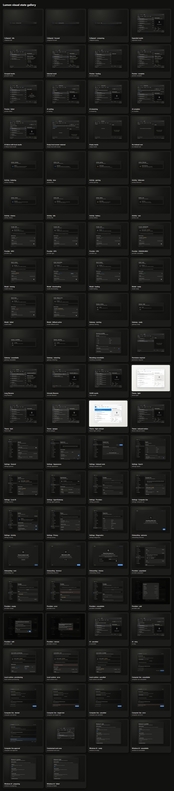

# Lumen

Lumen is a keyboard-first Windows 11 search and Computer Use experience built with Tauri 2, React 19, TypeScript, Tailwind CSS v4, React Aria Components, and Motion. Its owned EinUI command palette uses OpenAI Apps SDK UI icons within Lumen's semantic glass theme. It combines confined local-file search, local/cloud answers behind AgentGateway, and explicitly consented Gemini/OpenAI planning for fresh Edge sessions and selected Windows windows.



## Phase-one product

- Persistent borderless native window with Acrylic, Mica, Blur, and opaque fallbacks.
- Global `Alt+Space` invocation, single-instance redirection, active-monitor placement, and hide-on-close lifecycle.
- Collapsed launcher and expanded search workspace with scopes, filters, stable selection, action bar, virtualized 10,000-result handling, and responsive preview.
- Keyboard-complete search, details, open, containing-folder, settings, onboarding, and dialog flows.
- Four-step onboarding and eleven settings pages covering appearance, roots, search, local AI, AgentGateway, provider profiles, Computer Use, activity, privacy, and diagnostics.
- Light, dark, opaque, reduced-effects, reduced-motion, and forced-colors/high-contrast presentation.
- Typed local-file search, metadata, preview, and opener commands confined to user-selected roots.
- A Rust Computer Use coordinator with semantic Edge/UI Automation routes, a credential-free local executor, scoped approvals, Fast/Background modes, and native Ctrl+Alt+Esc Stop.
- Availability-checked Windows AI and Agent Launcher controls, the public App Content Search catalogue integration (currently blocked pending Microsoft activation), and current-host Edge AI detection in existing settings pages.
- Development-only 86-scenario visual gallery, screenshot set, contact sheet, six interaction recordings, accessibility/DPI suites, and a strict high-refresh profiler.

The normal Tauri application always uses the real local-file adapter. Deterministic memory data is available only to development tests, recordings, and gallery routes.

The answer path is provider-neutral at the React boundary and routes typed requests through native services. The native AgentGateway provider/model registry and MCP services, plus local vector-backed semantic search and ranking, have implemented paths behind typed services. Their use still depends on host availability, local runtime/vector support, configuration and consent. `FutureProductionSearchService` remains an intentionally unavailable adapter stub; the normal Tauri application uses the real local-file/index adapter. These source paths do not establish broad live-provider or release acceptance.

## Production readiness

**Not production-ready yet.** The 2026-10-15 checkpoint verifies implemented source and owned fixtures, not complete release acceptance. Typecheck, lint, 751 frontend tests, 383 Rust library tests, 26 Rust integration tests, staging and an **unsigned** installer build passed on product source `8a337eb`. The full Edge run failed (129 passed, 3 failed, 2 not run); 26 Rust tests were ignored and are tracked individually. See the [Windows gate report](docs/reports/2026-10-15-final-windows-gates.md).

Work still required before production:

- **Enrichment runtime:** diagnose and repair the intermittent compiled-worker ArrayBuffer crash, add a reproducing regression, then pass the original staged recovery gate. Instrumented diagnostic passes do not establish a fix; the original caller and invalidating operation remain unknown.
- **Dependency security:** resolve or document a supported-target exception for the open Dependabot alert GHSA-wrw7-89jp-8q8g (`glib 0.18.5` in `src-tauri/Cargo.lock`; fixed upstream in 0.20.0). The locked offline default Windows-target tree reports no `glib` path; finish supported-feature/platform triage before choosing a compatible update or accepting an exception.
- **Performance and browser acceptance:** meet the unchanged ordinary-query React p95 <3 ms and strict refresh budgets, resolve/revalidate cold-start accessibility failures, and pass the complete Edge suite. Current ordinary p95 is 10.4 ms. Refresh native WebView2 measurements, the 86-state gallery, six recordings and final performance evidence. See [performance evidence](docs/reports/2026-10-15-performance-continuation.md).
- **Native capacity and recovery:** complete 50,000-file and traversal-cap workloads with actual completion/normal joins, cold indexing, warm queries, edit/delete propagation, cancellation, settled resources and restart. The 1,000-file run completed; the later 50,000-file run is **UNCLOSED**, not a pass. Extend large-document resource and disk-full/interrupted-migration acceptance. See [capacity evidence](docs/reports/2026-10-15-native-search-capacity.md).
- **Real Prime:** run pinned Docker/Prime execution, ACP delivery, isolation/resource limits, recovery, promotion/rejection, cancellation and rollback. Docker acceptance is explicitly deferred by the owner; deterministic fixtures are separate.
- **Live AI and providers:** exercise supported local/cloud routes and all five real tool clients, authentication/expiry, unavailable models, rate limits, fallback, Stop/Retry, restart and OAuth cancellation. See [provider acceptance](docs/reports/2026-10-15-provider-workflow-source-validation.md).
- **Installed Computer Use:** validate both providers through the installed app, approval denial/retry, target loss/reuse, Background restrictions, revoked consent, native emergency Stop and owned-process cleanup. See [Computer Use acceptance](docs/reports/2026-10-15-computer-use-acceptance.md).
- **Signed distribution:** provision the owner's existing Windows signing certificate, verify final signed payloads, and test clean installation, state-preserving upgrade, interrupted upgrade, uninstall and process cleanup. The successful unsigned build does not establish these outcomes. See [release acceptance](docs/reports/signed-release-and-upgrade-acceptance.md).
- **Physical Windows accessibility/lifecycle:** complete Narrator, real IME, text scaling, high contrast, mixed-DPI monitors, sleep/resume and shortcut-conflict testing. See [physical acceptance](docs/reports/2026-10-15-windows-physical-acceptance.md).
- **Final release evidence:** obtain a passing complete hosted `Verify and package` run for the release commit and reconcile all failed, ignored and pending gates. Local, browser, native, installed, live-provider and physical evidence remain separate.

Optional Windows capabilities retain explicit unavailable states until their prerequisites exist: App Content Search needs Microsoft's feature ID, token and attestation; eligible hardware/runtime checks and signed optional identity acceptance remain outstanding. Aion remains excluded pending a stable redistributable contract. Automatic updating is optional follow-up; the first release uses signed installer updates.

## Requirements

- Windows 11 with the Microsoft Edge WebView2 Runtime.
- Bun 1.3 or newer.
- Rust stable with the MSVC target.
- Visual Studio 2022 or Build Tools with Desktop development with C++ and the Windows SDK.
- Python 3.11 (directly or through `uv`) when staging the Computer Use sidecar from source; installed applications include the compiled worker.
- .NET 10 SDK when building the Windows AI helper from source; staged helpers include their .NET runtime.

Install dependencies and start the native development app:

```powershell
bun install
bun run stage:sidecars
bun run tauri dev
```

The first run asks for one development search root. Press `Alt+Space` from another application to reopen the warm launcher.

## Windows integrations

Open Settings with `Ctrl+,`. Local AI contains the Windows/Edge enable switches, local answer engine, capability status, explicit preparation, engine test and native access-token setup. Privacy contains separate permissions for downloads, selected-preview text tools, OCR, image descriptions and local microphone dictation, plus language settings. Search controls local scopes, ranking, and the public App Content Search catalogue; that Windows API remains blocked until Microsoft activation is available. Local vector-backed semantic search is a separate optional path whose availability depends on the local runtime and vector support. AgentGateway controls installed Windows agents and Lumen's opt-in agent registration. Diagnostics reports the current host, runtime, provider and per-feature availability.

The launcher uses only ready, enabled engines. Automatic local answers prefer a ready Windows model and otherwise use the existing local runtime. An explicitly selected unsupported engine shows an error; cloud answers retain their separate consent. Preview tools run on an explicit press. Local dictation updates the draft and exposes Stop. Windows agent activations fill a browser-task draft that still needs the user's Run action and cloud consent.

The Windows helper is built and verified by `bun run stage:windows-ai`, also included in `stage:sidecars` and release builds. It targets the stable Windows App SDK/runtime 2.5.1. Preview features require their actual Windows runtime, hardware and access prerequisites. Identity-dependent APIs additionally need [the optional signed identity package](packaging/windows/README.md). Stable App Content Search remains blocked until Microsoft issues the feature-specific ID, token and attestation; the helper stops before search/index operations. Native Aion has no verified stable redistributable contract and is unavailable on every architecture; Aion and experimental AI speech artifacts are excluded. Edge APIs are detected in the executing browser/WebView2 realm; an installed Edge version does not establish their availability. Availability refresh never downloads models or starts microphone capture.

The App Content Search catalogue is limited to shipped public help/actions, but indexing and search stay unavailable pending Microsoft's separate activation contract. Personal file content stays in the confined SQLite index. Preview SDK provenance and distribution terms are recorded in [the helper notices](workers/windows-ai/THIRD_PARTY.md); local preview build evidence does not establish production redistribution rights.

The [Windows and Edge verification report](docs/reports/2026-10-04-windows-ai-integrations.md) records the implemented controls, current host availability, local quality gates and remaining checks on eligible preview hardware.

## Verification and evidence

```powershell
bun run typecheck
bun run lint
bun run test
bun run test:e2e
bun run profile
bun run capture:gallery
bun run record:interactions
bun run tauri build
```

Rust validation runs from `src-tauri` inside a Visual Studio developer shell:

```powershell
cargo fmt --all -- --check
cargo clippy --all-targets --all-features -- -D warnings
cargo test --all-features
```

Generated evidence is checked in under `artifacts`:

- `artifacts/screenshots/contact-sheet.png` and `manifest.json`: all 86 deterministic states; this preserved gallery evidence is not production acceptance.
- `artifacts/recordings/manifest.json`: six silent WebM interaction studies.
- `artifacts/performance/profile-summary.json`: machine-readable budgets, measurements, burst guards, browser version, and source SHA.
- `artifacts/performance/interaction-trace.zip`: Playwright trace for the measured interaction run.

The 86-state browser gallery and six recordings are historical deterministic artifacts, not current native or release acceptance. The [launcher-native appearance report](docs/reports/2026-10-15-launcher-native-appearance.md) links the owned synthetic fixture captures and provenance; it does not establish ordinary-app, packaged, physical-display, or performance acceptance.

The NSIS installer is generated under `src-tauri/target/release/bundle/nsis`. Build outputs are not committed.

## Architecture

- `src/app`: composition, startup, route boundaries, and providers.
- `src/design-system`: semantic tokens, themes, material, icons, type, primitives, and motion.
- `src/features`: launcher, results, preview, onboarding, settings, activity, gateway, local-AI, diagnostics, and gallery surfaces.
- `src/services`: search, answer, Computer Use, Windows AI, Edge AI and settings contracts plus native, browser, deterministic, and unavailable adapters.
- `src/platform`: Tauri/window abstractions.
- `src-tauri/src`: native window lifecycle and confined local-file commands.
- `tests/e2e`: keyboard, accessibility, DPI, visual, responsive, and performance acceptance.
- `docs/architecture`: design, motion, shell, management, and search-service boundaries.
- `docs/reports`: accessibility, DPI, high-refresh, and phase-one validation evidence.

Start with [the Computer Use architecture](docs/architecture/computer-use.md), [the search-service boundary](docs/architecture/search-service.md), and [native shell architecture](docs/architecture/native-shell.md).

## Security and scope boundary

Local search commands canonicalize every root and requested path. Paths outside a selected root are rejected, symlinks are not followed, generated dependency/build directories are skipped, text previews are capped at 64 KiB, image previews at 4 MiB, and binary text is not returned to the webview. The Tauri capability does not grant shell execute or spawn permissions.

The webview cannot launch arbitrary processes, contact Computer Use providers directly, or read provider credentials. Computer Use accepts typed tasks, target discovery, approval responses, and Stop through Rust IPC. Rust keeps provider keys in native requests; the fixed local executor receives no credentials. Browser cloud consent and the two desktop grants are independent. Tasks, selected-target observations and optional screenshots leave the device only within the recorded scope. Background mode forbids foreground escalation, and Stop reports uncertain in-flight outcomes without implying rollback.
